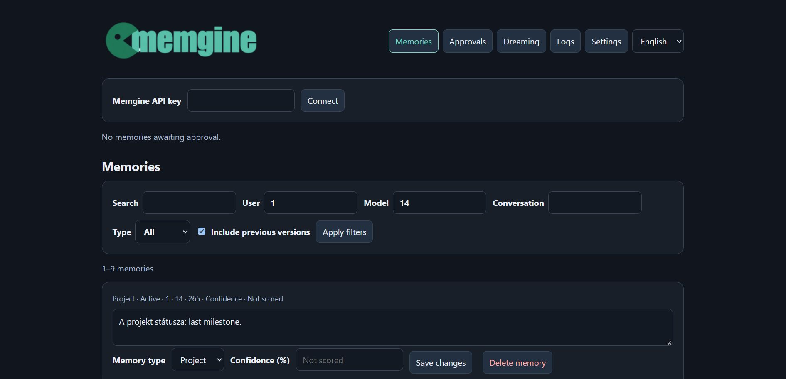

# Memgine

Memgine gives local AI assistants a memory you can inspect and edit. It extracts candidate memories from conversation messages, stores approved memories in SQLite, and retrieves relevant context for later conversations.



## Features

- **Memory review** — approve, edit, or dismiss suggestions, with optional feedback. Edit saved memories and their confidence scores.
- **Scoped retrieval** — profile and context memories can follow a user across conversations for the same client and model. Project memories also require a matching conversation ID. Search supports lexical matching and optional SPLADE ranking.
- **Dreaming** — combine related profile and context memories into a proposed summary. A separate Critic call checks it against the cited sources. When you approve the summary, you can archive the sources it fully replaces.
- **Integration** — connect through the memory HTTP API or the optional OpenAI-compatible chat proxy.

## Quick start

Memgine is in early development. Run it on Linux with Python 3.10 or newer. For extraction and Dreaming, run an OpenAI-compatible chat-completions endpoint separately.

From the repository root:

```bash
umask 077
cp -n memgine.example.ini memgine.ini
python3 -c 'import secrets; print(secrets.token_urlsafe(32)); print(secrets.token_urlsafe(32))'
```

Set `[api] key` and `[ui] settings_key` in `memgine.ini` to the two generated values. Set `[extractor] url` and `model` to match your model endpoint. The example uses port 8085 and model name `mara-memory`. Keep `review_required = true` for a manual first run.

```bash
python3 server.py
```

Open [the local Memgine interface](http://127.0.0.1:8079/) and connect using the API key. Use the settings key to unlock configuration. For a remote Linux host, access the loopback listener through an SSH tunnel.

In a second Bash terminal, from the same directory, submit a sample message:

```bash
read -rs -p 'Memgine API key: ' MEMGINE_TEST_KEY
printf '\n'
curl --fail-with-body http://127.0.0.1:8079/v1/memory/ingest \
  -H "Authorization: Bearer $MEMGINE_TEST_KEY" \
  -H 'Content-Type: application/json' \
  -d '{"user_id":"demo","model_id":"assistant","conversation_id":"first-chat","message_id":"1","text":"Please remember that I prefer concise explanations."}'
unset MEMGINE_TEST_KEY
python3 server.py work
```

The worker processes queued messages and exits. Open **Approvals** to review the proposed memory. To try **Dreaming**, first approve at least two related profile or context memories, then enter their user and model IDs on the Dreaming tab.

Keep your local configuration, API keys, and SQLite database out of commits.

## Integration

| Interface | Entry point |
| --- | --- |
| Ingest a message | `POST /v1/memory/ingest`, then run `python3 server.py work` |
| Recall memories | `POST /v1/memory/search` with `user_id`, `model_id`, `query`, and optionally `conversation_id` |
| Run Dreaming | `POST /v1/memory/dream` with `user_id` and `model_id` |
| Start the chat proxy | `python3 chat_proxy.py` |

The proxy exposes `GET /v1/models` and `POST /v1/chat/completions`. Configure `[proxy] key` and `upstream_url` in `memgine.ini`. A chat client opts into memory by sending `X-Memgine-Conversation-ID` and `X-Memgine-Message-ID`.

## Roadmap

- Make the Critic independently configurable so it can use its own model with fresh context.
- Track source versions already examined together, so Dreaming can revisit topics when their sources change.
- Evaluate weighted topic ranking once the consolidation workflow has more test coverage.

See [BENCHMARKS.md](BENCHMARKS.md) for the evaluation checklist.
